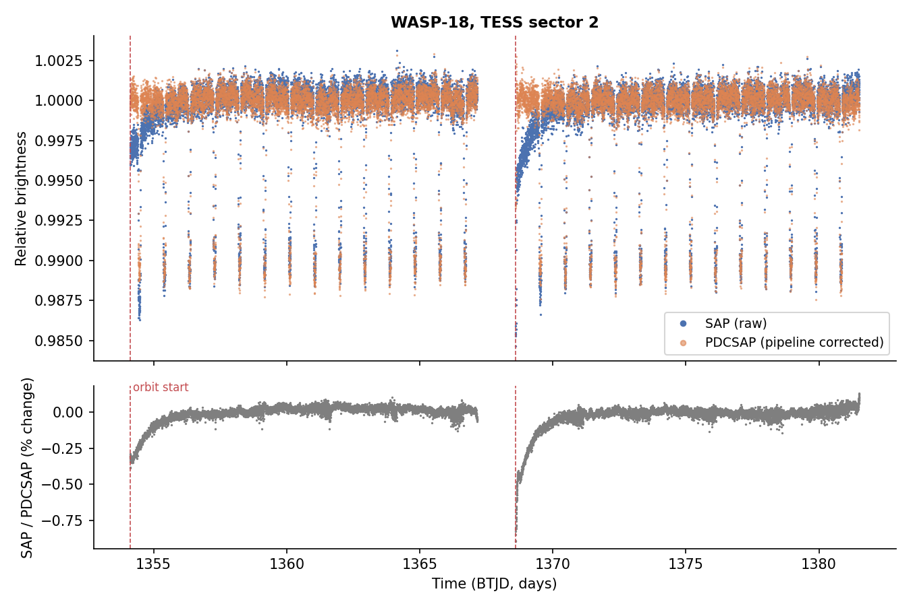
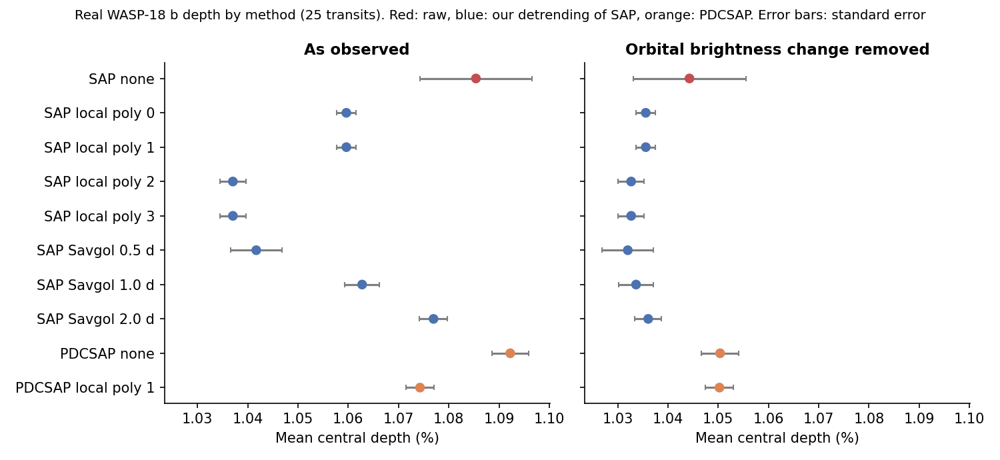
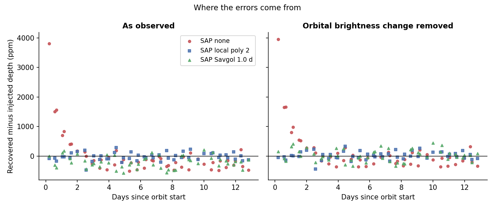

# TESS Transit Depth and Light Curve Detrending

## Research question

How does light curve detrending affect the accuracy of measuring the depth of a known exoplanet's transit in TESS observations?

## What this project did

1. Built a simple simulation to learn how a slow drift biases a measured transit depth.
2. Took real TESS data for WASP-18 b (sector 2, 2 minute cadence) from MAST.
3. Measured the depth of 25 transits with ten ways of handling the trend.
4. Injected fake transits of known depth into the real light curve and measured them back.
5. Checked the results against published numbers for the same planet.

## Main results

These hold for one planet in one sector. They show what to check. They are not a rule for all planets.

* Raw (SAP) data give single transit depths that scatter by about 560 ppm. Other methods scatter by 95 to 256 ppm.
* The first transit after each orbit start is much deeper in raw data. The ramp at the start of each orbit is the cause.
* Mean depths differ by up to 552 ppm (about 5 percent) between methods.
* A real brightness change over the planet's orbit biases simple baselines by about 200 ppm. Its sign depends on where the transit sits in the orbit.
* After dividing out a fitted version of that change, the spread among SAP based methods falls from 484 to 123 ppm.
* Injection tests: undetrended error is about 690 ppm (RMSE). Local polynomial fits of degree 2 or 3 give about 135 ppm.

Full text and tables: `docs/paper_draft.md`. Settings and logs: `docs/project_log.md`.





## How to run

The analysis has no random steps. Running it again gives identical tables.

In Google Colab (replace `YOUR_USERNAME`):

```
!git clone https://github.com/YOUR_USERNAME/tess-transit-detrending
%cd tess-transit-detrending
!pip install -r requirements.txt
!python tests/test_transit_detrend.py
!python src/run_analysis.py data/wasp18_sector2.csv results
!python src/reference_checks.py data/wasp18_sector2.csv results
!python src/make_figures.py data/wasp18_sector2.csv results figures
```

On your own computer, use the same commands without the `!` in a terminal inside the project folder.

Each command does one job:

| Command | What it does |
|---|---|
| `tests/test_transit_detrend.py` | Checks the tools on synthetic light curves with known answers |
| `src/run_analysis.py` | Finds the transit times, measures every method, runs the injection tests, writes `results/` |
| `src/reference_checks.py` | Compares our fitted brightness change and expected depth with published values |
| `src/make_figures.py` | Draws the figures from the saved tables |

## Folder layout

| Folder | Purpose |
|---|---|
| `src` | Python code. `transit_detrend.py` holds the tools. The other files are scripts that use it |
| `tests` | Tests on synthetic data |
| `data` | The exported light curve (`wasp18_sector2.csv`) and the record of where it came from |
| `results` | Tables written by the analysis, and `analysis_settings.json` with every setting |
| `figures` | Figures used in the draft paper |
| `notebooks` | The Colab notebook that downloaded the data, and an earlier exploration script |
| `docs` | The project log and the paper draft |

## Data

TESS sector 2, WASP-18 (TIC 100100827), SPOC pipeline, 120 second cadence, from MAST. Details are in `data/README.md`.

## Limits

One planet, one sector, a simple depth estimator, and a brightness model fitted to the same data. The full list is in Section 7 of the paper draft.
