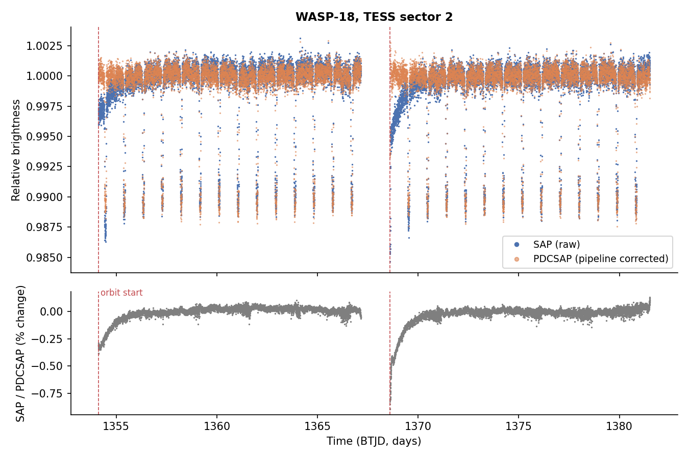
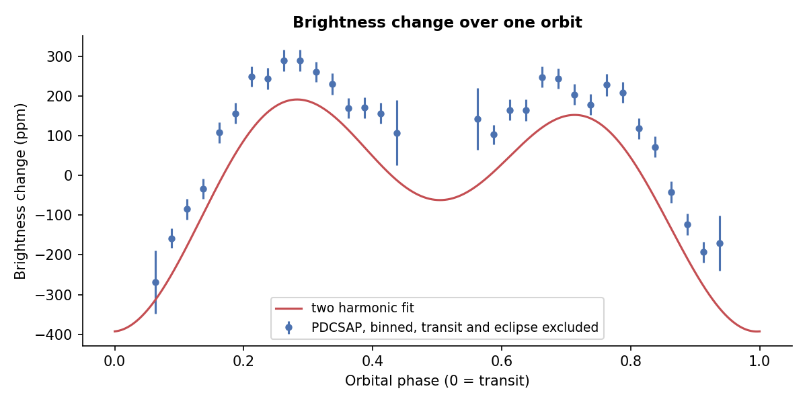
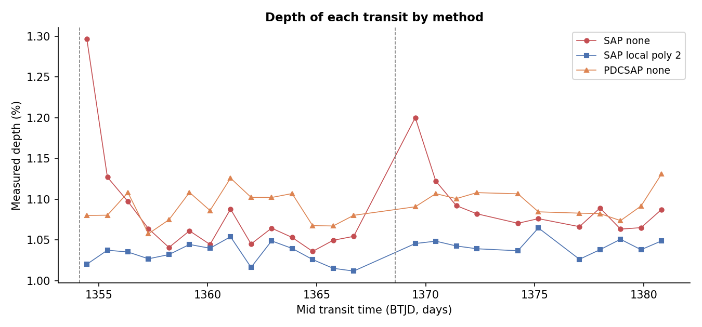
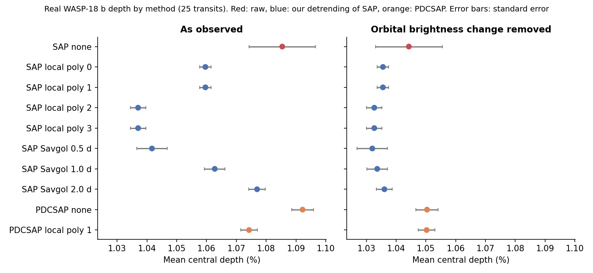
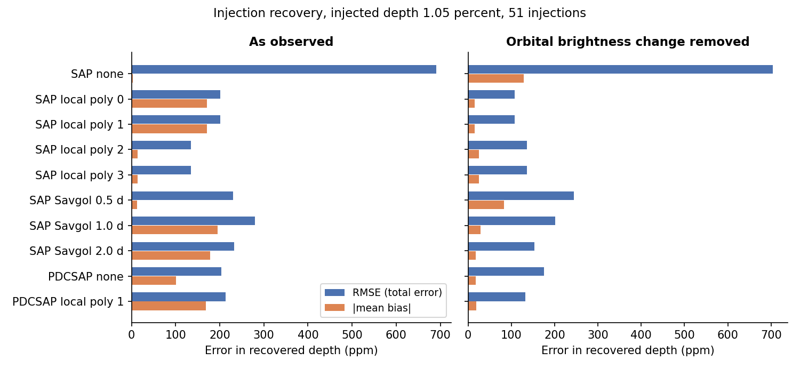
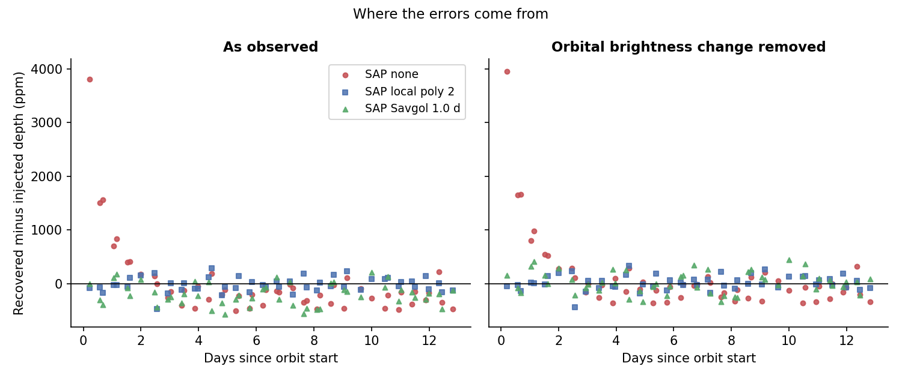
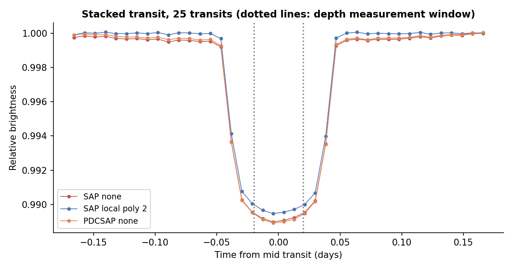

# How Light Curve Detrending Changes the Measured Transit Depth of WASP-18 b in TESS Data

**Author:** Shaheer
**Status:** First draft. Numbers come from the files in `results/`. Please read every claim and check it against the tables before sharing.

## Abstract

Transit depth is a basic measurement in exoplanet science. Detrending removes slow changes in brightness before the depth is measured. We ask how the choice of detrending changes the depth of one known planet, WASP-18 b, in one TESS sector. We use the raw (SAP) and pipeline corrected (PDCSAP) light curves of sector 2. We compare ten ways of handling the trend. We also inject fake transits of known depth and test how well each method recovers them. With no detrending, single transit depths from raw data scatter by 560 ppm, against 95 to 256 ppm for the other methods. The first transit after an orbit start is deeper in raw data than in the local polynomial result by up to 2,764 ppm. Across all methods, mean depths differ by 552 ppm, about 5 percent of the depth. A smooth change in the planet and star brightness over the orbit appears to explain much of the remaining difference between simple and flexible fits. When we divide out a fitted version of that change, the spread among methods that use the raw data drops from 484 to 123 ppm. Our results are for one planet in one sector. They show what to check, not a rule for all planets.

## 1. Introduction

A transit makes a star look fainter for a short time. The fraction of light blocked is the depth. To first order it is the square of the planet to star radius ratio. Real light curves also contain slow changes that do not come from the planet. TESS data show ramps at the start of each orbit. Hot planets also change the brightness of the system over each orbit. A common step is to fit and remove these slow changes before measuring the depth. The step has a cost. A fit that is too simple leaves a bias. A fit that is too flexible adds scatter or removes real signal.

Our question is: **how does light curve detrending affect the accuracy of measuring the depth of a known exoplanet's transit in TESS observations?** We study WASP-18 b. It is a massive planet on a 0.94 day orbit around a bright star (Hellier et al. 2009). Its transit is deep, about one percent, so each transit is well measured. It was observed at 2 minute cadence in sector 2, and a published analysis of the same data exists (Shporer et al. 2019).

## 2. What happened

We measured the depth of 25 transits in sector 2 with ten methods. The data and code are listed in Section 6.

**Finding 1. Raw data give noisy and sometimes badly biased single transit depths.** The raw (SAP) light curve has ramps at the start of each orbit. The ratio of SAP to PDCSAP flux is lower by about 0.32 percent at the start of orbit 1 and about 0.51 percent at the start of orbit 2. It settles to within about 0.1 percent after 0.9 days in orbit 1 and 1.1 days in orbit 2 (Figure 1). Single transit depths from undetrended SAP data scatter by 560 ppm between transits. The scatter for every other method is between 95 and 256 ppm. The transits closest to an orbit start are the worst (Table 1, Figure 3).

| Transit | Days since orbit start | SAP none (ppm) | SAP local poly 2 (ppm) | PDCSAP none (ppm) |
|---|---|---|---|---|
| 0 | 0.35 | 12,965 | 10,201 | 10,800 |
| 1 | 1.29 | 11,271 | 10,374 | 10,804 |
| 16 | 0.92 | 12,001 | 10,456 | 10,907 |
| 17 | 1.86 | 11,222 | 10,485 | 11,068 |

*Table 1. Depth of the first two transits after each orbit start. The polynomial detrended depth is much more stable. The raw depth is higher near the start of an orbit.*

**Finding 2. The mean depth depends on the method.** Table 2 gives the mean depth over 25 transits. The standard errors are small, between 19 and 51 ppm for all methods but undetrended SAP (112 ppm). So differences of a few hundred ppm are far larger than the statistical errors. The largest difference between two methods is 552 ppm.

| Method | Depth as observed (ppm) | Depth with orbital brightness change removed (ppm) |
|---|---|---|
| SAP none | 10,854 ± 112 | 10,443 ± 112 |
| SAP local poly 0 | 10,596 ± 19 | 10,356 ± 19 |
| SAP local poly 1 | 10,596 ± 19 | 10,356 ± 19 |
| SAP local poly 2 | 10,370 ± 26 | 10,327 ± 26 |
| SAP local poly 3 | 10,371 ± 26 | 10,327 ± 26 |
| SAP Savgol 0.5 d | 10,417 ± 51 | 10,320 ± 51 |
| SAP Savgol 1.0 d | 10,628 ± 34 | 10,337 ± 34 |
| SAP Savgol 2.0 d | 10,770 ± 28 | 10,361 ± 27 |
| PDCSAP none | 10,922 ± 37 | 10,504 ± 37 |
| PDCSAP local poly 1 | 10,743 ± 28 | 10,502 ± 28 |

*Table 2. Mean central depth over 25 transits, with standard errors. Depth is measured in the central 0.04 days of the transit (see Section 6).*

**Finding 3. Injection tests show which methods are most accurate on this light curve.** We injected a transit of 10,500 ppm into transit free parts of the real light curves, one at a time, 51 times, and measured it back. Without detrending, the typical error is 691 ppm. For local polynomial fits of degree 2 or 3 it is 134 ppm. Most of the raw error comes from injections in the first 1.5 days of an orbit. There, the mean error is 1,684 high ppm (5 injections). Later in the orbit it is 180 low ppm (46 injections). Five injections is a small sample, so we treat this as a clear sign and not a precise number (Figures 5 and 6).

| Method | RMSE as observed (ppm) | Mean error as observed (ppm) | RMSE with orbital change removed (ppm) | Mean error with orbital change removed (ppm) |
|---|---|---|---|---|
| SAP none | 691 | 3 high | 704 | 128 high |
| SAP local poly 0 | 202 | 171 low | 107 | 15 high |
| SAP local poly 1 | 202 | 171 low | 108 | 15 high |
| SAP local poly 2 | 134 | 14 low | 136 | 26 high |
| SAP local poly 3 | 135 | 14 low | 136 | 25 high |
| SAP Savgol 0.5 d | 230 | 13 low | 244 | 83 high |
| SAP Savgol 1.0 d | 280 | 195 low | 201 | 29 high |
| SAP Savgol 2.0 d | 233 | 178 low | 153 | 18 high |
| PDCSAP none | 204 | 101 low | 176 | 18 high |
| PDCSAP local poly 1 | 214 | 168 low | 133 | 19 high |

*Table 3. Injection recovery for an injected depth of 10,500 ppm. RMSE is the root mean square error. The mean error is the average of recovered minus injected depth. A second injected depth of 3,000 ppm gave the same errors to within 5 ppm (see `results/injection_recovery_summary.csv`).*

**Finding 4. The raw mean can look fine while single transits are wrong.** The undetrended SAP mean error in Table 3 is close to zero as observed. The RMSE is not. Large positive errors near orbit starts cancel small negative errors elsewhere. A mean alone would hide this.

## 3. Why it happened

**Reason 1. Instrumental ramps.** The SAP flux is lower at the start of each orbit (Figure 1). If the baseline is taken from the whole light curve, a transit measured during the ramp sits on a lower baseline. Its depth is measured against the wrong level and comes out too deep. Local fits and moving filters follow the baseline and remove most of this.

**Reason 2. A real brightness change over the orbit.** WASP-18 b changes the brightness of the system over each orbit. Shporer et al. (2019) report a cosine term at the orbital period of about minus 174 ppm and a term at half the period of about minus 191 ppm. We fitted two harmonics to the PDCSAP flux outside transit and eclipse. We found a cosine term of minus 165 ppm, a half period term of minus 190 ppm, and a sine term of plus 21 ppm (published: about plus 21 ppm). These agree well with the published values. Our fit used one sector and no formal uncertainties, so we treat this as a consistency check only (Figure 2).

This brightness change has curvature at the transit. Transits sit at its minimum. A flat or straight line baseline, taken from points on both sides, then sits too high, and the depth comes out too large. Our injection tests sit at quarter orbit phases, where the curvature has the opposite sign, so the same fits give depths too small. A simple calculation with our fitted harmonics predicts, for a flat baseline, a depth error of plus 240 ppm at the transit position. The prediction for degree 0 minus degree 2 is plus 196 ppm. We measured plus 226 ppm. At the injection positions the prediction is minus 193 and minus 180 ppm. We measured a mean of minus 171 ppm. These are close (`results/reference_checks.json`). Degrees 2 and 3 follow the curvature and remove most of the effect. This also explains why degrees 0 and 1 give the same depth here, and degrees 2 and 3 give the same depth. The windows are symmetric around the transit, so odd terms cancel in the average.

**Reason 3. Separating the two effects.** When we divide a fitted orbital brightness change out of the data, the spread among the SAP based methods falls from 484 to 123 ppm. The difference between PDCSAP with and without local fitting falls from 180 to 1 ppm (Figure 4). The mean injection errors of the degree 0 to 3 local fits fall to under 30 ppm (Table 3). So the ramp effect looks instrumental. Much of the remaining low degree error looks tied to the orbital brightness change. We did not test other causes.

**Reason 4. The window and the depth definition matter too.** For local fits, the mean depth rises as the window gets wider, because more of the curved baseline enters the fit. It also changes with the width of the measuring window, because the bottom of a real transit is curved (limb darkening). Table 4 shows the range of mean depth over window half widths from 0.14 to 0.30 days and measuring half widths from 0.015 to 0.03 days. These ranges are comparable to the differences between methods. So any comparison must state these choices.

| Method | Lowest depth (ppm) | Highest depth (ppm) | Range (ppm) |
|---|---|---|---|
| SAP none | 10,643 | 10,921 | 278 |
| SAP local poly 0 | 10,329 | 10,814 | 485 |
| SAP local poly 1 | 10,329 | 10,813 | 485 |
| SAP local poly 2 | 10,152 | 10,609 | 457 |
| SAP local poly 3 | 10,153 | 10,609 | 456 |
| SAP Savgol 0.5 d | 10,192 | 10,483 | 291 |
| SAP Savgol 1.0 d | 10,409 | 10,695 | 286 |
| SAP Savgol 2.0 d | 10,551 | 10,837 | 286 |
| PDCSAP none | 10,706 | 10,993 | 287 |
| PDCSAP local poly 1 | 10,472 | 10,966 | 494 |

*Table 4. Range of mean depth over window and measuring width choices, as observed.*

**Reason 5. SAP and PDCSAP differ in scale.** After removing the orbital change, PDCSAP depths are higher than SAP depths by about 1.5 percent. This is a difference in flux scaling, not in detrending. We did not trace it. A possible cause is the crowding correction applied by the pipeline, which can be checked in the file header. For this reason we compare methods within SAP and within PDCSAP, not across them.

**A reference check.** Published parameters (Shporer et al. 2019: radius ratio 0.09716, impact parameter 0.318, scaled semi major axis 3.562, limb darkening 0.2192 and 0.3127) give a squared radius ratio of about 9,440 ppm. A simple limb darkened calculation using those numbers predicts a mean depth of about 10,524 ppm in our central window. Our values with the orbital change removed are 10,320 to 10,443 ppm for SAP methods and 10,504 ppm for PDCSAP. This is a rough sanity check. It is not a measurement of truth. Published depths for this planet differ by method and by definition.

## 4. How it happened: a toy simulation

To see the mechanism without real data, we simulated a transit of 5 percent depth with 500 points, noise of 0.2 percent, and a sine wave drift. This simulation was run by the author in Google Colab. All values below are from those runs.

* With the drift added to the flux and the data divided by a polynomial fit, the mean depth error levelled off near 0.0004 below the true depth from degree 3 to degree 8. It did not reach zero.
* The cause was the simulation itself. When the drift was applied by multiplication instead, the levelling off disappeared. Degrees 4 to 8 gave mean errors between 0.00003 below and 0.00005 above the true depth. A choice made when building a simulation can create a bias that looks like a detrending effect.
* More flexible fits increased the scatter of single measurements. It rose from about 0.00032 to about 0.00042 between degree 0 and degree 8.
* The best degree depended on the speed of the drift and on where the transit sat in it. Table 5 shows the RMSE (times 1000) for six drift periods.

| Drift period (days) | Degree 0 | 1 | 2 | 3 | 4 | 5 | 6 | 7 | 8 |
|---|---|---|---|---|---|---|---|---|---|
| 0.30 | 0.90 | 1.23 | 0.32 | 0.38 | 0.93 | 2.98 | 3.22 | 3.14 | 5.27 |
| 0.50 | 5.78 | 8.18 | 8.53 | 6.12 | 6.19 | 0.48 | 0.58 | 0.68 | 0.77 |
| 0.75 | 4.15 | 3.94 | 7.37 | 3.84 | 2.22 | 1.16 | 0.40 | 0.40 | 0.42 |
| 1.00 | 9.89 | 6.17 | 6.42 | 0.83 | 0.84 | 0.35 | 0.39 | 0.39 | 0.42 |
| 1.50 | 6.18 | 3.60 | 1.08 | 0.39 | 0.35 | 0.35 | 0.39 | 0.39 | 0.42 |
| 3.00 | 1.40 | 0.70 | 0.38 | 0.35 | 0.35 | 0.35 | 0.39 | 0.39 | 0.42 |

*Table 5. Toy simulation. RMSE times 1000 of the measured depth, 100 noise draws per cell, drift amplitude 0.01, transit at 0.3 days. The best degree was 2, 5, 7, 5, 4 and 5 for periods 0.3 to 3.0 days. Several of these are ties. The result at period 0.3 days is probably luck: the transit sits where the drift crosses zero.*

These simulations show three things. A drift can bias depth. Detrending can remove most of it. And there is no single best polynomial degree. The result is specific to the sine drift we chose.

## 5. So what

1. **Report the choices.** The depth changed by hundreds of ppm with the method, the window, and the measuring width. A depth without these settings cannot be compared with another depth.
2. **Test with injections.** Real data has no known true depth. Injecting a transit of known depth into the real light curve shows how a method behaves on that data. This is cheap and it is informative.
3. **Look at single transits, not only the mean.** The undetrended mean looked fine while single transits were up to 27 percent deeper than the local polynomial result.
4. **Treat the orbital brightness change as signal.** Fitting a smooth curve through everything outside the transit can absorb real variation. For hot, massive planets this changes the baseline at the level of 2 percent of the depth.
5. **Be careful with the word raw.** SAP is raw in the sense that the pipeline did not correct it. PDCSAP is already partly detrended by a method the analyst did not choose.

## 6. Methods

**Data.** TESS sector 2 light curves of WASP-18 (TIC 100100827), SPOC pipeline, 120 second cadence, from MAST through Lightkurve 2.6.0. The file is `tess2018234235059-s0002-0000000100100827-0121-s_lc.fits`. We used the SAP and PDCSAP flux columns with the default quality flags. There are 18,299 cadences and no missing values. Each flux column was divided by its median.

**Ephemeris.** A Box Least Squares search (Kovács et al. 2002) gave a first period. We then fitted a periodic trapezoid to the PDCSAP flux for the period, mid transit time, duration and ingress time. The results are period 0.941459 days, T0 1354.45776 (BTJD), total duration 0.0908 days (2.18 hours) and ingress time 0.0122 days. This fit is used only for timing and shape. These values agree with published ones (Shporer et al. 2019): their transit time near BTJD 1354.45782 and period 0.9414526 days.

**Masks.** Points within 0.75 transit durations of mid transit (±0.068 days) and of mid eclipse (phase 0.5) were never used to fit a baseline.

**Depth.** The primary estimate is one minus the mean detrended flux in the central 0.04 days of each transit. A second estimate scales a trapezoid shape to the data. It gives lower depths by about 3 percent but a similar pattern across methods (`results/real_depth_summary_shape_estimator.csv`).

**Methods compared.** (1) SAP with no detrending, divided by the median of masked data. (2 to 5) SAP with a polynomial fitted to the baseline within 0.17 days of each transit, degrees 0 to 3. (6 to 8) SAP with a Savitzky Golay filter of order 2 and windows of 0.5, 1.0 and 2.0 days, with masked points filled by straight lines, run on each orbit separately. (9) PDCSAP with no further detrending. (10) PDCSAP with a local polynomial of degree 1.

**Usable transits.** A transit was used only if its window held at least 90 percent of the expected central points and at least 40 baseline points on each side. The same 25 of 29 transits were used for all methods. Two of the four that were not usable fall in the gap between orbits. The other two have missing cadences.

**Injection and recovery.** A trapezoid transit with the fitted duration and ingress time was multiplied into the flux at orbital phases 0.25 and 0.75, away from real transits and eclipses. Injected depths were 10,500 and 3,000 ppm. Each injection was measured on its own with every method, with real transits, real eclipses and the injected transit masked. This gave 51 injections per depth. The test was repeated on data where a two harmonic orbital brightness model, fitted to PDCSAP outside transit and eclipse, had been divided out.

**Reproducibility.** The analysis has no random steps. Rerunning `src/run_analysis.py` gave identical tables. Tests on synthetic light curves with known answers are in `tests/`.

## 7. Limits

1. One planet and one sector. The ramps and the planet's brightness change are specific to this case.
2. The depth estimator is simple. A full transit model fit with limb darkening would be better for absolute depth. We used the simple estimator to keep every step visible.
3. The orbital brightness model is fitted to the same data. We use it for a check, not for the main result.
4. Injection depths were placed at orbital phases 0.25 and 0.75. The orbital brightness change has the opposite curvature there compared with the real transit position.
5. Only five injections fell in the first 1.5 days of an orbit.
6. Standard errors treat transits as independent and ignore systematic effects shared between methods.
7. The toy simulation used one drift shape.
8. We did not trace the offset between SAP and PDCSAP depth.

## Data and code availability

Data: MAST, TESS sector 2, TIC 100100827, SPOC light curve file named above. A CSV extract is in `data/wasp18_sector2.csv`. Code, tables and figures: this repository.

## Acknowledgements

This paper uses data from the Mikulski Archive for Space Telescopes. The analysis code and this draft were developed with the help of an AI assistant (Claude). [Author: describe in your own words what you checked and decided yourself.]

## References

These were checked against the reference list of Shporer et al. (2019) or are standard citations. Please verify each one against the original before submission.

1. Hellier, C., et al. 2009, Nature, 460, 1098.
2. Shporer, A., et al. 2019, TESS full orbital phase curve of the WASP-18b system, AJ (arXiv:1811.06020).
3. Kovács, G., Zucker, S., & Mazeh, T. 2002, A&A, 391, 369.
4. Ricker, G. R., et al. 2015, JATIS, 1, 014003.
5. Smith, J. C., et al. 2012, PASP, 124, 1000.
6. Stumpe, M. C., et al. 2014, PASP, 126, 100.
7. Jenkins, J. M., et al. 2016, Proc. SPIE, 9913, 99133E.
8. Claret, A. 2017, A&A, 600, A30.
9. Lightkurve Collaboration 2018, Astrophysics Source Code Library, ascl:1812.013.

## Figures

*Figure 1. Normalized SAP and PDCSAP flux, and their ratio. The ramps at the start of each orbit are in SAP only.*

*Figure 2. Brightness change over one orbit in the PDCSAP flux outside transit and eclipse, with the two harmonic fit.*

*Figure 3. Measured depth of each transit for three methods. Dashed lines mark orbit starts.*

*Figure 4. Mean depth by method, as observed and after removing the fitted orbital brightness change. Both panels share the same horizontal axis.*

*Figure 5. Injection recovery error by method.*

*Figure 6. Injection error against days since orbit start.*

*Figure 7. Stacked transit after detrending, for three methods.*
